 

**Available for freelance work.** I build AI agents and automation that hold up in production: idempotent runs, cost limits, audit logs and clear security boundaries around anything that touches a shell, an inbox or a CRM.

 

## What I build

 

## Stack

 

## Selected work

| Project | What it is |
| --- | --- |
| [lead-qualifier-agent](https://github.com/franciscoaraujo23/lead-qualifier-agent) | Agent that qualifies inbound leads |
| [n8n-b2b-lead-generation](https://github.com/franciscoaraujo23/n8n-b2b-lead-generation) | n8n workflow for B2B prospecting |
| [n8n-b2b-email-outreach](https://github.com/franciscoaraujo23/n8n-b2b-email-outreach) | n8n workflow for email outreach with approval |
| [hermes-agent-security-audit](https://github.com/franciscoaraujo23/hermes-agent-security-audit) | Security audit of an autonomous agent with shell access |

More case studies, with the numbers behind them, on [franciscoaraujo.eu](https://franciscoaraujo.eu).

 

Based in Porto, Portugal. I work in English and Portuguese. Co-founder at Nautica AI.

