 

**Available for freelance projects in AI agents and business automation.**
I build the systems around the model call: the part that decides whether an agent survives real use.

&nbsp;&nbsp;

 

## Problems I solve

Any business process that needs an AI agent or automation, not only the examples further down. The problems repeat from project to project, and so does the fix.

 

## Stack

 

## Examples of the work

These are where I proved the approach, not the limit of what I take on. Each one has a written case study and the code.

| Case study | What it does | Code |
| --- | --- | --- |
| [Chat to Booked Call](https://franciscoaraujo.eu/projects/sales-chatbot/) | A sales agent for a website: answers questions, qualifies the visitor and opens a pre-filled booking calendar. Live on the Nautica AI site. | [n8n-ai-sales-chatbot](https://github.com/franciscoaraujo23/n8n-ai-sales-chatbot) |
| [Map to Call List](https://franciscoaraujo.eu/projects/lead-generation/) | Finds companies on Google Places, removes duplicates before any paid step, qualifies them with an LLM and writes them to a Notion CRM. | [n8n-b2b-lead-generation](https://github.com/franciscoaraujo23/n8n-b2b-lead-generation) |
| [Call List to Inbox](https://franciscoaraujo.eu/projects/email-outreach/) | Cold emails built from facts checked against each company's website. The drafts land in Gmail and a person sends them. | [n8n-b2b-email-outreach](https://github.com/franciscoaraujo23/n8n-b2b-email-outreach) |
| [Domain to Decision](https://franciscoaraujo.eu/projects/lead-qualifier/) | Takes a company domain, enriches it from public sources, scores it with an LLM and drafts the outreach. | [lead-qualifier-agent](https://github.com/franciscoaraujo23/lead-qualifier-agent) |
| [Securing a Self-Hosted Autonomous Agent](https://franciscoaraujo.eu/projects/hermes/) | A security audit of an AI agent with shell access: three fixes, each shown before and after. | [hermes-agent-security-audit](https://github.com/franciscoaraujo23/hermes-agent-security-audit) |

 

## Work with me

Have a system that needs to hold up in production? Tell me what it should do and what must never go wrong: [hello@franciscoaraujo.eu](mailto:hello@franciscoaraujo.eu).

 

Based in Portugal, working remotely in English and Portuguese. Co-founder and technical lead at Nautica AI.

