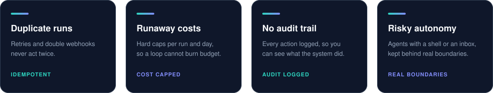

 

**Available for freelance projects in AI agents and business automation.**
I build the systems around the model call: the part that decides whether an agent survives real use.

&nbsp;&nbsp;

 

## Problems I solve

Any business process that needs an AI agent or automation, not only the examples further down. The problems repeat from project to project, and so does the fix.

 

## Stack

 

## Examples of the work

These are where I proved the approach, not the limit of what I take on. The three pinned repositories below cover one pipeline end to end: finding companies, qualifying them, and drafting outreach that a person reviews and sends.

Also worth a read: [hermes-agent-security-audit](https://github.com/franciscoaraujo23/hermes-agent-security-audit), a security audit of a self-hosted autonomous AI agent with shell access, with three fixes shown before and after.

Full case studies on [franciscoaraujo.eu](https://franciscoaraujo.eu).

 

## Work with me

Have a system that needs to hold up in production? Tell me what it should do and what must never go wrong: [hello@franciscoaraujo.eu](mailto:hello@franciscoaraujo.eu).

 

Based in Portugal, working remotely in English and Portuguese. Co-founder and technical lead at Nautica AI.

